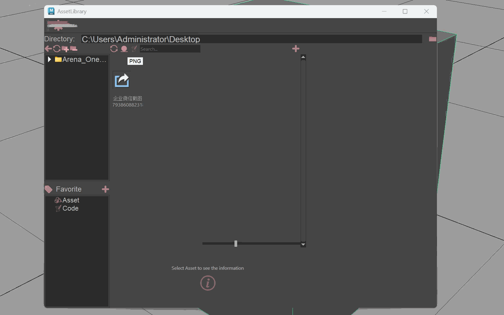

# 🗂️ AssetLibrary · 资产库浏览器 / Asset Library Browser

一个跑在 **Maya / 3ds Max / Blender** 里的资产浏览器：像逛素材网站一样翻缩略图，双击就能打开、导入或引用资产。
An asset browser that runs inside **Maya / 3ds Max / Blender**: browse thumbnails like a stock-asset website, then open / import / reference with one double-click.



---

## 🇨🇳 中文

### ✨ 这个工具能干什么

- 🖼️ **缩略图浏览**：文件夹和资产以卡片形式铺开，资产多也不卡（只加载看得见的部分）。
- 🖱️ **右键直接用**：`Open` / `Import` / `Reference`，路径一键复制，直接在当前 DCC 里生效。
- ⭐ **收藏夹**：常去的目录收藏起来，支持分组、重命名、拖动排序。
- 🔍 **搜索**：顶部搜索框快速过滤资产或脚本。
- 💻 **代码面板**：浏览、新建、编辑、运行 `.py` 脚本，不用来回切脚本编辑器。
- 📤 **发布**：把资产文件夹按规则复制到指定发布目录，复制的文件列表会先给你看一遍。
- 📸 **视口缩略图**：右键 `Generate Thumbnail from Viewport`，把当前视口截一帧当封面。

### 🚀 快速开始

```python
import sys
sys.path.append(r"<你的路径>/AssetLibrary/source")

import assetLibrary_app
assetLibrary_app.main()
```

在 Maya 脚本编辑器 / Blender 文本编辑器里粘贴运行即可；不在 DCC 里时也能作为独立窗口启动。

### 🧭 第一次用，按这个顺序点

1. ⚙️ 点工具栏的设置按钮 → **Preference**。
2. 填 **Default Project Root Path**（资产根目录）、**Code Root Path**（脚本目录）。
3. 需要的话调 **Thumbnails size / quality**，保存。
4. 回到主界面，双击文件夹卡片进入，右键资产就能操作了。

### 🖱️ 常用右键菜单

| 对象 | 菜单项 | 作用 |
|------|--------|------|
| 资产文件 | `File Operation → Open / Import / Reference` | 在 DCC 里打开 / 导入 / 引用 |
| 资产文件 | `Open in Explorer` / `Copy Path` / `Copy` / `Delete` / `Rename` | 常规文件操作 |
| 资产文件 | `Generate Thumbnail from Viewport` | 用当前视口截图当缩略图 |
| 资产文件夹 | `Publish` | 发布到目标目录 |
| 资产文件夹 | `Set Preview Image` / `Set Cover from Viewport` | 设置文件夹封面 |
| 收藏项 | `Rename` / `Reset Name` / `Remove` | 管理收藏 |

### 📁 数据都存在哪（多人共享盘也不会打架）

原则：**共享盘只放"大家共用、只读"的东西，个人偏好和缓存一律写在本机。**

| 数据 | 位置 | 说明 |
|------|------|------|
| 程序代码、图标 | 共享盘（程序目录） | 只读，所有人共用 |
| 默认配置 `config/*.json` | 共享盘（程序目录） | 只作首次运行的种子，不改 |
| 偏好设置 / 收藏 | **本机**配置目录 | 每个用户独立 |
| 已发布缩略图 | 共享盘 `<资产目录>/.thumbnails/<资产名>.png` | 一人生成，所有人可见 |
| 本地兜底缩略图 | **本机**缓存目录 `overrides/` | 共享盘没写权限时自动落这里 |
| 缩略图解码缓存 | **本机**缓存目录 `thumb_cache/` | 纯加速，可随时删 |

本机目录（`asset_lib_utils/utils.py`）：

- 配置：Windows `%APPDATA%\AssetLibrary` ｜ macOS `~/Library/Application Support/AssetLibrary` ｜ Linux `~/.config/AssetLibrary`
- 缓存：Windows `%LOCALAPPDATA%\AssetLibrary\cache` ｜ macOS `~/Library/Caches/AssetLibrary` ｜ Linux `~/.cache/AssetLibrary`

> 💡 缩略图查找顺序：资产本身是图片 → 共享 sidecar → 本机 override → 默认图标。
> 手动放缩略图也行：把 `<资产名>.png` 丢进资产目录的 `.thumbnails/` 里。

### 🛠️ 部署到共享盘

1. 整个程序目录放共享盘，普通用户给**只读**权限即可。
2. 想让缩略图共享，只给"发布者"账号对 `.thumbnails/` 的**写**权限。
3. 普通用户不需要任何写权限 —— 偏好、收藏、缓存都自动写到各人本机。
### 📂 代码结构

```
source/
├── assetLibrary_app.py     # 主窗口 + 偏好设置（纯 Python，DCC 无关）
├── dcc_interface.py        # DCC 适配层（所有 DCC 专属 import 只在这里）
├── asset_lib_utils/
│   ├── utils.py            # 通用工具、AssetButton、缩略图加载器
│   ├── flowlayout.py       # 流式布局
│   └── code_panel.py       # 代码面板
├── icon/                   # 图标
└── config/                 # 默认配置
```

---

## 🇬🇧 English

### ✨ What it does

- 🖼️ **Thumbnail browsing**: folders and assets shown as cards; stays smooth with thousands of files (only visible items load).
- 🖱️ **Right-click to use**: `Open` / `Import` / `Reference` directly in the current DCC, plus copy path, copy, rename, delete.
- ⭐ **Favorites**: bookmark folders, group them, rename, drag to reorder.
- 🔍 **Search**: filter assets or scripts from the top search box.
- 💻 **Code panel**: browse, create, edit and run `.py` scripts without leaving the tool.
- 📤 **Publish**: copy an asset folder to a target directory with a file preview before copying.
- 📸 **Viewport thumbnails**: right-click `Generate Thumbnail from Viewport` to grab the current viewport as the cover.

### 🚀 Quick start

```python
import sys
sys.path.append(r"<your path>/AssetLibrary2/source")

import assetLibrary_app
assetLibrary_app.main()
```

Run it in the Maya script editor or Blender text editor. Outside a DCC it opens as a standalone window.

### 🧭 First-run checklist

1. ⚙️ Open the toolbar settings button → **Preference**.
2. Set **Default Project Root Path** (assets root) and **Code Root Path** (scripts).
3. Adjust **Thumbnails size / quality** if needed, then save.
4. Double-click a folder card to enter it, and right-click any asset to work with it.

### 🖱️ Common right-click menus

| Target | Menu item | What it does |
|--------|-----------|--------------|
| Asset file | `File Operation → Open / Import / Reference` | Open / import / reference in the DCC |
| Asset file | `Open in Explorer` / `Copy Path` / `Copy` / `Delete` / `Rename` | Regular file operations |
| Asset file | `Generate Thumbnail from Viewport` | Capture the current viewport as thumbnail |
| Asset folder | `Publish` | Publish to a target directory |
| Asset folder | `Set Preview Image` / `Set Cover from Viewport` | Set the folder cover |
| Favorite item | `Rename` / `Reset Name` / `Remove` | Manage favorites |

### 📁 Where data lives (safe on a shared drive)

Rule of thumb: **the shared drive holds read-only shared data; preferences and caches always stay on the local machine.**

| Data | Location | Notes |
|------|----------|-------|
| Code, icons | Shared drive (program dir) | Read-only, shared by everyone |
| Default `config/*.json` | Shared drive (program dir) | Seed only, never written at runtime |
| Preferences / favorites | **Local** config dir | Per user |
| Published thumbnails | Shared `<asset dir>/.thumbnails/<name>.png` | Written once, visible to all |
| Local fallback thumbnails | **Local** cache dir `overrides/` | Used when the shared drive is read-only |
| Decoded thumbnail cache | **Local** cache dir `thumb_cache/` | Pure speed-up, safe to delete |

Local paths (`asset_lib_utils/utils.py`):

- Config: Windows `%APPDATA%\AssetLibrary` ｜ macOS `~/Library/Application Support/AssetLibrary` ｜ Linux `~/.config/AssetLibrary`
- Cache: Windows `%LOCALAPPDATA%\AssetLibrary\cache` ｜ macOS `~/Library/Caches/AssetLibrary` ｜ Linux `~/.cache/AssetLibrary`

> 💡 Thumbnail lookup order: the asset itself (if it is an image) → shared sidecar → local override → default icon.
> Manual thumbnails work too: drop `<asset name>.png` into the asset folder's `.thumbnails/`.

### 🛠️ Deploying to a shared drive

1. Put the whole program dir on the shared drive; give regular users **read-only** access.
2. To share thumbnails, grant the "publisher" account **write** access to `.thumbnails/` only.
3. Regular users need no write access — preferences, favorites and caches go to their own local dirs.

### 📂 Code structure

```
source/
├── assetLibrary_app.py     # Main window + preferences (pure Python, DCC-agnostic)
├── dcc_interface.py        # DCC adapter layer (the only place with DCC imports)
├── asset_lib_utils/
│   ├── utils.py            # Helpers, AssetButton, thumbnail loader
│   ├── flowlayout.py       # Flow layout
│   └── code_panel.py       # Code panel
├── icon/                   # Icons
└── config/                 # Default config
```
